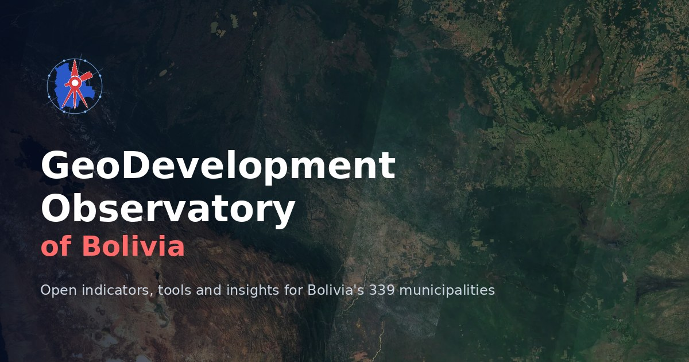

# GeoDevelopment Observatory of Bolivia (GDO-Bolivia)

[](https://quarcs-lab.github.io/geo4bolivia/)
[](https://pypi.org/project/geo4bolivia/)
[](https://pypi.org/project/geo4bolivia/)
[](https://github.com/quarcs-lab/geo4bolivia/actions/workflows/release.yml)
[](LICENSE) [](LICENSE-DATA)
[](https://colab.research.google.com/github/quarcs-lab/geo4bolivia/blob/main/notebooks/geo4bolivia_quickstart.ipynb)

**[Website](https://quarcs-lab.github.io/geo4bolivia/)** · **[Python package](https://pypi.org/project/geo4bolivia/)** · **[How the database works](docs/data-infrastructure.md)** · **[Quickstart notebook](https://colab.research.google.com/github/quarcs-lab/geo4bolivia/blob/main/notebooks/geo4bolivia_quickstart.ipynb)** · **[Cite](#-citation)**

The GeoDevelopment Observatory of Bolivia is a public-access platform for analyzing, monitoring and evaluating **sustainable regional development** in Bolivia, at every spatial scale: departments, provinces, municipalities, cities and grids. It has three parts:

- **GeoDevelopment Indicators:** social, economic and environmental indicators from satellite imagery, censuses and administrative records, at every spatial scale.
- **GeoDevelopment Tools:** Python packages, notebooks and web apps to load, build and analyze them.
- **GeoDevelopment Insights:** accessible research summaries.

It serves:

- **Researchers**, who need ready-made subnational panels with reproducible code
- **Decision-makers**, who design, target and evaluate regional policies
- **Citizens**, who want to understand development in their own municipality or department

It builds on [DS4Bolivia](https://github.com/quarcs-lab/ds4bolivia), whose municipal datasets are its first indicators.

## 🚀 Quickstart

```python
!pip install -q geo4bolivia                          # every snippet runs in Google Colab
import geo4bolivia as geo
import plotly.express as px                          # interactive maps and charts (preinstalled in Colab)

geo.datasets()                                       # what is available, at which scale and years
gdf = geo.load("sdg", variables="sdg1_2_mpi", years=2012, geometry=True)   # 339 municipalities with boundaries
px.choropleth_map(gdf, geojson=gdf.geometry, locations=gdf.index, color="sdg1_2_mpi",
                  hover_name="name", center={"lat": -16.3, "lon": -64}, zoom=4)
```

[](https://colab.research.google.com/notebooks/empty.ipynb)

---

## 📊 GeoDevelopment Indicators

All data share one spatial backbone. Every unit at every scale has a **geo ID** that nests by prefix (GADM 4.1 hierarchy): municipality `BO-04-17-04` (La Paz) lies in province `BO-04-17` (Murillo), which lies in department `BO-04` (La Paz), which lies in Bolivia `BO`. INE codes and DS4Bolivia's `asdf_id` are kept as columns of [`geo/units.csv`](geo/units.csv). Each dataset is a panel with one row per unit (`geo_id`) and year, published as CSV and Parquet.

| Dataset | Title | Scale | Period | Files |
| --- | --- | --- | --- | --- |
| [`pop`](docs/datasets/pop.md) | Population (gridded estimates) | 339 municipalities | 2001–2020 | [`data/municipality/`](data/municipality/) |
| [`ntl`](docs/datasets/ntl.md) | Night-time lights per capita (log) and its long-run trend | 339 municipalities | 2012–2020 | [`data/municipality/`](data/municipality/) |
| [`sdg`](docs/datasets/sdg.md) | 64 indicators of the Municipal Atlas of the SDGs 2020, each at its reference year | 339 municipalities | 2010–2020 | [`data/municipality/`](data/municipality/) |
| [`emb`](docs/datasets/emb.md) | Satellite embeddings, 64 dimensions, area-weighted | 339 municipalities | 2017 | [`data/municipality/`](data/municipality/) |
| [`embpw`](docs/datasets/embpw.md) | Satellite embeddings, 64 dimensions, population-weighted | 339 municipalities | 2017 | [`data/municipality/`](data/municipality/) |
| [`geo`](geo/) | Units, names, codes, boundaries and crosswalks for every scale | 461 units | — | [`geo/`](geo/) |

Each dataset has three descriptions:
- a [Frictionless datapackage](metadata/)
- a generated page in [`docs/datasets/`](docs/datasets/), with its variable dictionary, coverage, sources and citation
- its rows in [`definitions_gdo-bolivia.csv`](definitions_gdo-bolivia.csv), which lists every variable of every dataset

New municipalities keep being created in Bolivia. The 339 municipalities here follow GADM 4.1; data on a newer map will be published at their own scale and linked to this one by area-weighted overlay ([how](CONTRIBUTING_DATA.md#add-a-municipality-map-of-another-vintage)).

### Load the data: two ways

**1. With the package.** One line gives a panel with names and boundaries, filtered by years and variables:

```python
!pip install -q geo4bolivia
import geo4bolivia as geo

geo.dictionary("sdg")                                      # variables, units, reference years
mpi = geo.load("sdg", variables="sdg1_2_mpi", years=2012)  # one SDG indicator at its year
wide = geo.load("pop", wide="pop")                         # one column per year
geo.units("municipality")                                  # names, parents, INE and DS4Bolivia codes

geo.aggregate(geo.load("pop"), to="department", dataset="pop")    # municipalities -> departments
geo.aggregate(mpi, to="department", rules={"sdg1_2_mpi": "weighted_mean:pop"},
              weights=geo.load("pop"))                            # population-weighted poverty
geo.combine(["ntl", "pop"], scale="municipality")                 # two datasets, one panel
geo.load("ntl", ref="v0.1.0")                                     # a frozen release of the data
```

[](https://colab.research.google.com/notebooks/empty.ipynb)

**2. Without the package.** Every file is a plain URL that pandas and geopandas (both preinstalled in Colab) read directly:

```python
import pandas as pd
import geopandas as gpd

BASE = "https://raw.githubusercontent.com/quarcs-lab/geo4bolivia/main/"
df = pd.read_csv(BASE + "data/municipality/ntl.csv")               # geo_id, year, variables
units = pd.read_csv(BASE + "geo/units.csv")                         # names, parents, source codes
gdf = gpd.read_file(BASE + "geo/boundaries/municipality.geojson")   # polygons keyed by geo_id
```

[](https://colab.research.google.com/notebooks/empty.ipynb)

### Build your own indicators

The package can also:
- link your own tables to the same units, by names in any spelling or by INE and DS4Bolivia codes
- extract indicators from rasters
- move data onto grids or other zones
- save the results in the same documented format

```python
!pip install -q "geo4bolivia[raster]"                                      # [raster] adds rasterio for geo.zonal()
import geo4bolivia as geo

mine = geo.link(my_table, scale="municipality", on="mun_id", key="mun_id")   # INE code 20101 -> BO-04-17-04
ntl = geo.zonal("viirs_2020.tif", scale="municipality", name="ntl", year=2020)
panel = geo.combine(["pop"], scale="municipality", extra=[mine])
geo.save(panel, "my_indicator", scale="municipality", directory="my_data")
df, df_def = geo.for_expdpy(panel)                                          # inputs for expdpy (panel econometrics)
gdf, df, df_dict = geo.for_geometrics("ntl")                                # inputs for geometrics (spatial analysis)
```

[](https://colab.research.google.com/notebooks/empty.ipynb)

The full guide is [`docs/data-infrastructure.md`](docs/data-infrastructure.md). It covers the scales and IDs, the metadata and aggregation rules, and recipes for building indicators. To add a dataset to the observatory, see [`CONTRIBUTING_DATA.md`](CONTRIBUTING_DATA.md).

### A note on DS4Bolivia's homonyms

Three pairs of municipalities share a name across departments: San Javier (Beni, Santa Cruz), El Puente (Tarija, Santa Cruz) and Santa Rosa (Beni, Pando). In DS4Bolivia, the attribute rows of each pair (names, INE codes and the SDG Atlas indicators) are attached to the other polygon of the pair. GDO-Bolivia links the SDG indicators by INE code, so each lies in its own municipality, while population, lights and embeddings, which were computed from the polygons, follow the polygons. Details and evidence: [`raw/README.md`](raw/README.md).

---

## 🐍 GeoDevelopment Tools

### Python packages

| Package | What it does | Install (Google Colab) |
| --- | --- | --- |
| **[geo4bolivia](docs/python-package.md)** | Load every indicator as a panel with boundaries, link your own data, extract indicators from rasters, move data across scales | `!pip install -q geo4bolivia` |
| **[expdpy](https://cmg777.github.io/expdpy/)** | Panel exploration and econometrics: within/between variation, trajectories, fixed and random effects, Hausman tests, clustered SEs; `geo.for_expdpy()` prepares the observatory's data for it in one line | `!pip install -q geo4bolivia expdpy` |
| **[geometrics](https://quarcs-lab.github.io/geometrics/)** | Regional growth, convergence and inequality with spatial methods; `geo.for_geometrics()` prepares the observatory's data for it in one line | `!pip install -q geo4bolivia geometrics` |

### Cloud-based notebooks

| Notebook | Description |
| --- | --- |
| [Load, link and build indicators with geo4bolivia](https://colab.research.google.com/github/quarcs-lab/geo4bolivia/blob/main/notebooks/geo4bolivia_quickstart.ipynb) | Load data with and without the package, move it across scales, link your own table, and save an indicator |
| [Exploratory data analysis](https://colab.research.google.com/github/quarcs-lab/geo4bolivia/blob/main/notebooks/eda.ipynb) | Multidimensional poverty, night-time lights and population: summaries, departments, treemaps and scatter plots |
| [Exploratory spatial data analysis](https://colab.research.google.com/github/quarcs-lab/geo4bolivia/blob/main/notebooks/esda.ipynb) | Maps, spatial weights, Moran's I and LISA clusters of multidimensional poverty |
| [Spatial distribution and dependence](https://colab.research.google.com/github/quarcs-lab/geo4bolivia/blob/main/notebooks/esda_dependence.ipynb) | Box-plot and Fisher-Jenks maps, KNN weights, the spatial lag, Moran's I and LISA clusters at two significance levels |
| [Spatial inequality](https://colab.research.google.com/github/quarcs-lab/geo4bolivia/blob/main/notebooks/esda_inequality.ipynb) | Gini, Theil decomposition between and within departments, spatial Gini |
| [Spatial heterogeneity (GWR and MGWR)](https://colab.research.google.com/github/quarcs-lab/geo4bolivia/blob/main/notebooks/esda_heterogeneity.ipynb) | Where night-time lights predict poverty better or worse: geographically weighted regressions |
| [Extended EDA and ESDA](https://colab.research.google.com/github/quarcs-lab/geo4bolivia/blob/main/notebooks/eda_esda.ipynb) | A full workflow on poverty, infrastructure and lights: statistics, correlations, clusters and bivariate maps |
| [Predicting poverty from satellite embeddings](https://colab.research.google.com/github/quarcs-lab/geo4bolivia/blob/main/notebooks/embeddings_mpi_ml.ipynb) | Random forest and XGBoost predict multidimensional poverty from 64 embedding dimensions, with random and spatial (leave-one-department-out) cross-validation and residual maps |

### Web apps

- [GeoExplorer v1.0 — Bolivia](https://carlos-mendez.projects.earthengine.app/view/geoexplorer1v100bolivia): space-time dynamics of population, night-time lights, land cover and GDP, 2013–2019 (source in [`apps/`](apps/))

---

## 💡 GeoDevelopment Insights

Research that uses the municipal data will be summarised on the [website](https://quarcs-lab.github.io/geo4bolivia/#insights).

---

## 🛠️ For developers

### Repository structure

```text
geo4bolivia/
├── site/                         # The website: React + Tailwind sources, build.mjs, map boundaries (data/)
├── robots.txt, site.webmanifest
├── project.yaml                  # Project identity: name, package, repository, country codes
├── raw/                          # Original inputs, never edited (see raw/README.md)
├── geo/                          # Spatial backbone: scales.yaml, units, boundaries/, crosswalks/
├── data/<scale>/                 # Published panels: <dataset>.csv + .parquet (generated)
├── metadata/                     # One Frictionless datapackage per dataset (source of truth)
├── docs/                         # Guides (data-infrastructure, python-package, publishing) + datasets/ (generated)
├── definitions_gdo-bolivia.csv   # All variables of all datasets (generated)
├── src/geo4bolivia/              # Python package: load, link, zonal, aggregate, overlay, combine, save, build, validate
├── tests/                        # test_core.py (generic) + test_project.py (Bolivia facts)
├── notebooks/                    # Colab notebooks (.ipynb) paired with MyST markdown (.md)
├── apps/                         # Earth Engine app source code
├── code/                         # Pointers to data-preparation code
├── scripts/                      # web_boundaries.py, indicator maps, site images, new_project.py (template)
├── media/, images/               # Site assets
├── .github/workflows/            # release.yml (PyPI on version tags), pages.yml (builds and deploys the website)
├── CONTRIBUTING_DATA.md          # How to add a dataset, a scale or a municipality map of another vintage
├── TEMPLATE.md                   # How the geo4<country> template works
├── pyproject.toml, uv.lock       # Python package and environment (uv)
└── CITATION.cff, LICENSE (code), LICENSE-DATA (data), CLAUDE.md
```

### Run locally

```bash
uv sync                          # environment + the geo4bolivia package (editable)
uv run geo4bolivia build         # regenerate geo/, data/, docs/ from raw/
uv run geo4bolivia validate      # check IDs, schemas, nesting and file consistency
uv run pytest                    # run the test suite
uv run jupyter lab notebooks/    # open the notebooks
npm ci --prefix site             # website build tools (Node 20+), once
npm run --prefix site preview    # build the website and serve it at http://localhost:8765/
```

### Releasing the package

Bump the version in `pyproject.toml` and `src/geo4bolivia/__init__.py`, commit, and push a matching tag (`git tag vX.Y.Z && git push origin vX.Y.Z`). The [release workflow](.github/workflows/release.yml) publishes it to PyPI. Details, including the one-time setup, are in [`docs/publishing.md`](docs/publishing.md).

### Part of a family of projects

GDO-Bolivia was created from [geo4cambodia](https://github.com/quarcs-lab/geo4cambodia), the template of a family of `geo4<country>` projects. They share one design: geo IDs, long panels, Frictionless metadata and the same package API. Every project-specific setting lives in `project.yaml`. See [`TEMPLATE.md`](TEMPLATE.md).

### The website

The site's sources are in `site/`: a React app (`site/src/app.jsx`) whose items (indicators, packages, notebooks, apps, insights, events) are entries of the `CONTENT_REGISTRY` array in `site/src/content.js`. `site/build.mjs` bundles it with esbuild and Tailwind and pre-renders a page for every item at `<section>/<id>/`, with its own preview card and structured data, plus the sitemap, the search index and the data of the interactive maps. The [website workflow](.github/workflows/pages.yml) builds and deploys it to GitHub Pages on every push to `main`. The maps draw geoBoundaries' public-domain municipal boundaries (GeoBolivia), prepared by `scripts/web_boundaries.py`.

---

## 👥 Team

- [Carlos Mendez](https://carlos-mendez.org) (Nagoya University, Japan)

**Contact:** carlos.mendez.n9 [at] f.mail.nagoya-u.ac.jp

**Community:** questions and ideas are welcome in [GitHub Discussions](https://github.com/quarcs-lab/geo4bolivia/discussions).

---

## 📝 Citation

> Mendez, C. (2026). *GeoDevelopment Observatory of Bolivia*. <https://quarcs-lab.github.io/geo4bolivia/>

```bibtex
@misc{gdobolivia2026,
  author       = {Mendez, Carlos},
  title        = {{GeoDevelopment Observatory of Bolivia}},
  year         = {2026},
  howpublished = {\url{https://quarcs-lab.github.io/geo4bolivia/}},
  note         = {Data and code: https://github.com/quarcs-lab/geo4bolivia}
}
```

Please also cite the original source of each dataset you use. The citations are listed on each dataset's page in [`docs/datasets/`](docs/datasets/).

---

**Disclaimer.** The indicators, tools and insights are the responsibility of the individual researchers and do not necessarily represent the views of their affiliated institutions or related organizations. Maps are for geo-statistical use only. They have a referential, informational character and do not represent an official definition of Bolivia's territorial boundaries.

**License.** Code: [MIT](LICENSE). Data: [CC BY 4.0](LICENSE-DATA), except the GADM-derived boundary files (`geo/boundaries/`, free for non-commercial use; redistribution needs GADM's permission) and where an original source requires otherwise. Each dataset's sources, their licenses and the credits they ask for are listed in its metadata, its page in `docs/datasets/` and its page on the website. The indicator maps use Esri's World Dark Gray Canvas basemap (Esri, HERE, Garmin, © OpenStreetMap contributors). Section illustrations come from the geo4cambodia template (generated with OpenAI image generation via Codex); satellite imagery in the hero and the section backgrounds is Sentinel-2 cloudless 2016 by EOX IT Services GmbH (CC BY 4.0), except the Laguna Verde background from Sentinel-2 cloudless 2024 (CC BY-NC-SA 4.0), and NASA Blue Marble (public domain).
