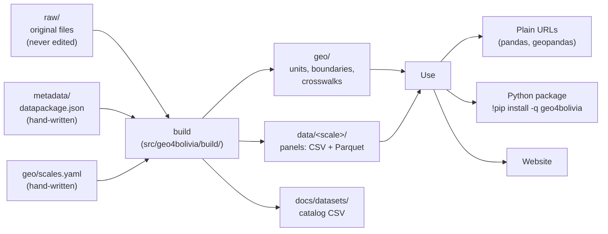

# How the data infrastructure works

This guide explains the **indicators database** behind the observatory: how spatial units, datasets and metadata fit together, how to load data (with or without the Python package), and how to build your own indicators with the package, for example in Google Colab.

> The examples use **geo4bolivia** and its datasets. The design comes from the [geo4cambodia](https://github.com/quarcs-lab/geo4cambodia) template, so every `geo4<country>` project works the same way with its own package name, country code and datasets. See [`TEMPLATE.md`](../TEMPLATE.md).

**Contents**

1. [The big picture](#1-the-big-picture)
2. [Spatial scales and geo IDs](#2-spatial-scales-and-geo-ids)
3. [The geography layer](#3-the-geography-layer-geo)
4. [The indicators database](#4-the-indicators-database)
5. [Loading data: two ways](#5-loading-data-two-ways)
6. [Building your own indicators](#6-building-your-own-indicators-with-the-package)
7. [Package reference](#7-package-reference)
8. [Maintaining the database](#8-maintaining-the-database)
9. [Design decisions](#9-design-decisions)

---

## 1. The big picture



Four rules hold everything together:

1. **Every spatial unit has one geo ID** (`geo_id`), at every scale. IDs nest by prefix: municipality `BO-04-17-04` (La Paz) lies in province `BO-04-17` (Murillo), which lies in department `BO-04` (La Paz), which lies in `BO`.
2. **Every dataset is a long panel**: one row per unit (`geo_id`) and `year`, one column per variable, stored in `data/<scale>/<dataset>.csv` and `.parquet`.
3. **Metadata is the source of truth.** A Frictionless datapackage per dataset describes every variable (description, unit, source, aggregation rule). Documentation is generated from it.
4. **Nothing published is edited by hand.** Original inputs stay untouched in `raw/`; `geo4bolivia build` regenerates `geo/`, `data/` and `docs/datasets/`, and `geo4bolivia validate` checks them.

| Folder or file | What it holds | Edited by hand? |
| --- | --- | --- |
| `project.yaml` | Project identity: name, package, GitHub repository, country code, equal-area projection | yes |
| `geo/scales.yaml` | The registry of spatial scales and their ID patterns | yes |
| `raw/` | Original inputs (data, boundaries, lookup tables) | added, never edited |
| `metadata/<dataset>.datapackage.json`, `metadata/index.json` | Dataset descriptions and the list of datasets | yes |
| `src/geo4bolivia/build/` | One builder per dataset, plus the geography builder | yes |
| `geo/units.*`, `geo/boundaries/`, `geo/crosswalks/` | The geography layer | generated |
| `data/<scale>/<dataset>.*` | Published panels | generated |
| `docs/datasets/*.md`, `data/README.md`, the catalog CSV | Documentation | generated |

---

## 2. Spatial scales and geo IDs

A **scale** is a set of units that tile the country: departments, provinces, municipalities, grid cells... Scales are registered in [`geo/scales.yaml`](../geo/scales.yaml):

```yaml
municipality:
  label: Municipality (339)
  kind: admin            # admin | grouping | grid | custom
  level: 3               # administrative level
  parent: province       # the next coarser scale it nests in exactly
  id_pattern: '^BO-\d{2}-\d{2}-\d{2}$'
  example: BO-04-17-04
  source: geoBoundaries gbOpen ADM3 (GeoBolivia, public domain), numbered as GADM 4.1 level 3
  status: active         # active: published in geo/ | planned: reserved
```

| Field | Meaning |
| --- | --- |
| `kind` | `admin`: administrative units that nest by ID prefix. `grouping`: unions of whole units of another scale (set `children:`). `grid`: regular cells. `custom`: any other zones (watersheds, historical boundaries) |
| `parent` | Coarser scale every unit lies in exactly. Defines the hierarchy used by `aggregate()` |
| `children` | For a grouping: the scale whose whole units it unites (e.g. statistical regions made of whole departments) |
| `id_pattern` | Regular expression every ID of the scale must match. Patterns must not overlap, so an ID tells its scale |
| `digits` | Zero-padding of this level's part of the ID (default 2) |
| `status` | `planned` reserves the scale and its ID scheme before data exist |

**Geo IDs in geo4bolivia**

| Scale | Units | Pattern | Example | Nests in |
| --- | --- | --- | --- | --- |
| `country` | 1 | `BO` | `BO` | — |
| `department` | 9 | `BO-NN` | `BO-04` (La Paz) | country |
| `province` | 112 | `BO-NN-NN` | `BO-04-17` (Murillo) | department → country |
| `municipality` | 339 | `BO-NN-NN-NN` | `BO-04-17-04` (La Paz) | province → department → country |
| `municipality_ine` | planned | `BO-INE-NNNNNN` | `BO-INE-020101` | (overlay) |
| `grid10k` | planned | `BO-G10K-rNNNcNNN` | `BO-G10K-r012c034` | (overlay) |

Administrative numbers follow the GADM order; the boundaries are geoBoundaries' (Bolivia: GeoBolivia's 2015 map, public domain), attached to the IDs by a one-off area match (`scripts/match_geoboundaries.py`, `build/geoboundaries.py`). geoBoundaries leaves salt flats and lakes outside every unit, so they are holes at every scale and `area_km2` excludes them. Codes from other sources are **kept as columns**, never used as keys: Bolivia's INE codes order the departments differently (La Paz is `BO-04` here and `02` in INE), so `ine_code` is a column of `geo/units.csv`, next to DS4Bolivia's `asdf_id` and the INE `mun_id`.

**Municipality maps of other vintages.** New municipalities are created over time, so later datasets may use a map with more units than these 339. Each map is its own scale with its own ID prefix (e.g. the planned `municipality_ine`), never a relabelling of `municipality`. Its boundaries are published like any other scale, and data move between maps with `overlay()` (area weights), or through a hand-checked lookup when units only split. See [`CONTRIBUTING_DATA.md`](../CONTRIBUTING_DATA.md).

---

## 3. The geography layer (`geo/`)

| File | Contents |
| --- | --- |
| `units.csv` / `.parquet` | One row per unit of every scale: `geo_id`, `scale`, `name`, `parent_id`; one `<scale>_id` column per scale it lies in (`country_id`, `department_id`, `province_id`, `municipality_id`); source keys (`gid` = GADM, `ine_code` = INE, and for municipalities `asdf_id` = DS4Bolivia polygon, `mun_id` = INE code as an integer and `gb_id` = geoBoundaries `shapeID`); the GADM spelling (`name_gadm`); `area_km2` |
| `boundaries/<scale>.geojson` / `.parquet` | Polygons in WGS 84 with `geo_id` and `name`. Coarser scales are dissolved from the finest one, so they nest exactly |
| `crosswalks/<from>__<to>.csv` | `geo_id_from`, `geo_id_to`, `weight_area` for every nested pair, finer to coarser (`municipality__province.csv`) |

The `<scale>_id` columns make any join across scales a one-liner: every municipality row already says its province, department and country.

---

## 4. The indicators database

### Datasets

A **dataset** is a set of variables from one source, published at one or more scales:

```
data/municipality/ntl.csv        geo_id, year, asdf_id, ln_NTLpc, ln_t400NTLpc
data/municipality/ntl.parquet    the same table, typed and compressed
metadata/ntl.datapackage.json
docs/datasets/ntl.md             generated: dictionary, coverage, sources, citation
```

Each table is a **long panel**: one row per unit and year, sorted by `geo_id` and `year`. Optional `source_key` columns (here `asdf_id`) keep the original identifier next to `geo_id` for traceability. Wide tables (one column per year) are produced on demand, never stored.

| Dataset | Scale | Years | Variables |
| --- | --- | --- | --- |
| `pop` | municipality (339) | 2001–2020 | gridded population |
| `ntl` | municipality (339) | 2012–2020 | log night-time lights per capita and its HP trend |
| `sdg` | municipality (339) | 2010–2020 | 64 indicators of the Municipal Atlas of the SDGs 2020, each at its reference year |
| `emb` | municipality (339) | 2017 | 64 satellite embedding dimensions, area-weighted |
| `embpw` | municipality (339) | 2017 | the same, population-weighted |

A cross-sectional source fits the same shape: each variable is stored at its reference year. The SDG Atlas indicators come from different years (e.g. poverty from the 2012 census, infant mortality from 2016), so `sdg` has one row per municipality and reference year, and a variable has values only in its year (`geo:year` in the metadata says which).

### Metadata

`metadata/<dataset>.datapackage.json` is a [Frictionless Data Package](https://datapackage.org/) with one resource per scale. Project-specific information lives in `geo:` properties:

| Level | Property | Meaning |
| --- | --- | --- |
| package | `name`, `title`, `description`, `licenses`, `sources` | standard Frictionless fields; `licenses` is the license of the published files (CC BY 4.0 unless a source requires otherwise) |
| package | `geo:categories`, `geo:citation`, `geo:notes`, `geo:notebooks` | shown on the dataset page |
| package | `geo:map` | the website's headline map: `{"variable", "year"}`, optionally `"scale"` and `"classify": "log"` (checked by `validate`) |
| package | `geo:updated` | date of the last update, shown in the page's License section |
| source | `title`, `path` | full citation and its DOI or URL |
| source | `geo:role`, `geo:creator`, `geo:homepage` | `original` (produced the data) or `intermediary` (a tool, repository or boundary set it passed through); who made it; the data's home page |
| source | `geo:license`, `geo:attribution` | the source's own license (`{name, title, path}`) and the credit sentence it asks for |
| resource | `path` | public URL of the CSV (checked by `validate`) |
| resource | `geo:scale`, `geo:period` | the scale and `[first, last]` year |
| resource | `geo:path`, `geo:parquet` | file paths inside the repository |
| resource | `geo:source_geometry` | polygons the values were computed on, if different from `geo/boundaries` |
| field | `type`, `constraints` | standard Table Schema (`pattern`, `minimum`, `maximum`, `required`) |
| field | `title`, `description` | the label for plots and how the variable was built; required for every field (checked by `validate`) |
| field | `geo:role` | `id`, `time`, `source_key` (with `geo:units_column`) or `variable` (default) |
| field | `geo:unit`, `geo:source` | unit of measure and source of the variable |
| field | `geo:aggregation` | how the variable moves to coarser scales (below) |
| field | `geo:year` | for variables observed once: the year they are stored at |

`metadata/index.json` lists the dataset ids, so remote users can discover them.

### Aggregation rules

| Rule | Use for | Example |
| --- | --- | --- |
| `sum` | counts and totals | population, GDP, zonal sums of lights |
| `weighted_mean:<field>` | rates and averages, weighted by another field | poverty weighted by `pop` |
| `mean`, `min`, `max` | unweighted summaries (use with care) | — |
| `none` | values that cannot be aggregated without more data | logs, HP trends, per-capita values without population |

`aggregate()` raises an error for `none` variables you ask for explicitly and otherwise leaves them out with a warning; `combine()` drops them with a warning. Pass `rules=` to keep them. `overlay()` needs you to say which variables are *extensive* (totals, split by area) and which are *intensive* (rates, area-weighted means).

---

## 5. Loading data: two ways

All code below assumes **Google Colab**: each block starts with the line that installs what Colab lacks, so it runs in a new notebook once you replace placeholder inputs (your own tables, rasters or zones).

### A. Without the package

Every file is a plain URL: `https://raw.githubusercontent.com/quarcs-lab/geo4bolivia/main/<path>`. Use `main` for the latest data, or a release tag (e.g. `v0.3.0`) for a frozen version. pandas, geopandas and plotly are preinstalled in Colab, so nothing needs installing:

```python
import pandas as pd
import geopandas as gpd
import plotly.express as px

BASE = "https://raw.githubusercontent.com/quarcs-lab/geo4bolivia/main/"

df = pd.read_csv(BASE + "data/municipality/ntl.csv")                   # panel: geo_id, year, variables
units = pd.read_csv(BASE + "geo/units.csv")                             # names, parents, source keys
df = df.merge(units[["geo_id", "name", "department_id"]], on="geo_id")

gdf = gpd.read_file(BASE + "geo/boundaries/municipality.geojson")       # polygons with geo_id, name
gdf = gdf.merge(df.loc[df.year == 2020, ["geo_id", "ln_NTLpc"]], on="geo_id")
px.choropleth_map(gdf, geojson=gdf.geometry, locations=gdf.index, color="ln_NTLpc",
                  hover_name="name", center={"lat": -16.3, "lon": -64}, zoom=4).show()

xw = pd.read_csv(BASE + "geo/crosswalks/municipality__department.csv")  # municipality -> department
```

[](https://colab.research.google.com/notebooks/empty.ipynb)

### B. With the package (Python)

```python
!pip install -q geo4bolivia
import geo4bolivia as geo

geo.datasets()                                     # datasets x scales x years
geo.dictionary("ntl")                              # variables, labels, units, aggregation rules
df  = geo.load("ntl")                              # panel: geo_id, year, variables
gdf = geo.load("ntl", years=2020, geometry=True)   # GeoDataFrame, ready to map
w   = geo.load("pop", wide="pop")                  # one row per municipality, pop2001 ... pop2020
mpi = geo.load("sdg", variables="sdg1_2_mpi", years=2012)   # one SDG indicator at its year
names = geo.units("municipality")                  # names, parents, source keys
shapes = geo.boundaries("department")
xw = geo.crosswalk("municipality", "department")
geo.load("ntl", ref="v0.2.0")                      # a frozen release of the data
```

[](https://colab.research.google.com/notebooks/empty.ipynb)

Inside a clone of the repository the package reads the local files. Anywhere else it downloads them from GitHub, caching each file for the session.

| | Without the package | With the package |
| --- | --- | --- |
| Install (Colab) | nothing | `!pip install -q geo4bolivia` |
| Names, boundaries | merge `geo/units.csv`, `geo/boundaries/*.geojson` yourself | `geometry=True`, `geo.units()` |
| Filters, wide format | by hand | `years=`, `variables=`, `wide=` |
| Across scales | join a crosswalk and aggregate by hand | `geo.aggregate()`, `geo.overlay()`, `geo.combine()` |
| Your own data | — | `geo.link()`, `geo.zonal()`, `geo.check()`, `geo.save()` |
| Panel econometrics | prepare inputs yourself | `geo.for_expdpy()` → [expdpy](https://cmg777.github.io/expdpy/) |
| Spatial analysis | prepare inputs yourself | `geo.for_geometrics()` → [geometrics](https://quarcs-lab.github.io/geometrics/) |

---

## 6. Building your own indicators with the package

Everything below runs in Google Colab. Each block starts with its install line: `!pip install -q geo4bolivia`, or `!pip install -q "geo4bolivia[raster]"` when it uses `zonal()` (the extra adds rasterio).

### Recipe 1: link your own table by unit names or codes

Data from a report, survey or ministry usually identifies units by name, often spelled differently. `geo.link()` attaches `geo_id`, ignoring accents, case, spaces and punctuation, and tries every name and code column of `geo.units()`:

```python
!pip install -q geo4bolivia
import pandas as pd
import geo4bolivia as geo

mine = pd.DataFrame({
    "Departamento": ["La Paz", "SANTA CRUZ", "Potosi"],
    "year": [2020, 2020, 2020],
    "schools": [4875, 3712, 2361],
})
mine = geo.link(mine, scale="department", on="Departamento")   # adds geo_id: BO-04, BO-08, BO-07
geo.check(mine, scale="department")                             # [] means it is a valid panel

# DS4Bolivia tables and INE statistics: link by their codes
codes = pd.DataFrame({"mun_id": [20101, 70101], "teachers": [9120, 11034]})
codes = geo.link(codes, scale="municipality", on="mun_id", key="mun_id")   # BO-04-17-04, BO-08-01-05
```

[](https://colab.research.google.com/notebooks/empty.ipynb)

Unmatched values raise an error that suggests the closest spelling (`errors="warn"` to continue). Pass `key=` to match a specific code: `"gid"` (GADM), `"ine_code"` (INE, as text with leading zeros, e.g. `"020101"`), `"mun_id"` (INE, as a number) or `"asdf_id"` (DS4Bolivia polygon).

Some names are shared by several units: six pairs of municipalities (El Puente, Entre Ríos, San Javier, San Pedro, San Ramón, Santa Rosa) and four provinces called Cercado. `geo.link()` never guesses between them: such rows stay unlinked and the error lists the candidate units, so link municipalities by code where you can.

### Recipe 2: extract an indicator from a raster

Summarise any GeoTIFF (an Earth Engine export, WorldPop, a land-cover map) over the units of a scale:

```python
!pip install -q "geo4bolivia[raster]"
import geo4bolivia as geo

lights = geo.zonal("viirs_2020.tif", scale="municipality", stats=["sum", "mean"], name="ntl", year=2020)
# geo_id, year, ntl_sum, ntl_mean

series = geo.zonal({2019: "viirs_2019.tif", 2020: "viirs_2020.tif"}, scale="municipality", name="ntl")
```

[](https://colab.research.google.com/notebooks/empty.ipynb)

Pixels count when their centre falls inside a unit (`all_touched=True` for very small units); nodata is ignored. URLs work too.

### Recipe 3: combine datasets and derive a new indicator

`geo.combine()` loads several datasets at one scale, aggregating finer ones with their metadata rules:

```python
!pip install -q geo4bolivia
import geo4bolivia as geo

import numpy as np

panel = geo.combine(["ntl", "pop"], scale="municipality", years=(2012, 2020))
panel["ntl"] = np.exp(panel["ln_NTLpc"]) * panel["pop"]          # total lights, from the per-capita log

# add your own data at the same scale
panel = geo.combine(["pop"], scale="municipality", extra=[my_municipal_table])
```

[](https://colab.research.google.com/notebooks/empty.ipynb)

Variables without an aggregation rule are dropped with a warning when they would need aggregating; columns with the same name get the dataset id as prefix (e.g. `emb_A00`, `embpw_A00`).

### Recipe 4: move data across scales

```python
!pip install -q geo4bolivia
import geo4bolivia as geo

pop = geo.load("pop", years=2020)

# up a nested hierarchy, with the metadata rules
geo.aggregate(pop, to="department", dataset="pop")
geo.aggregate(pop, to="country", dataset="pop", variables=["pop"])

# your own rules: municipal poverty (2012) as a population-weighted mean by department
mpi = geo.load("sdg", variables="sdg1_2_mpi", years=2012)
geo.aggregate(mpi, to="department", rules={"sdg1_2_mpi": "weighted_mean:pop"}, weights=geo.load("pop"))

# onto units that do not nest: a grid, watersheds, a newer municipality map
cells = geo.overlay(pop, my_grid, extensive=["pop"], id_col="cell")
weights = geo.overlay_weights("municipality", my_zones, id_col="zone")   # the area shares used
```

[](https://colab.research.google.com/notebooks/empty.ipynb)

`overlay()` assumes values are spread evenly within each source unit. Totals (`extensive`) are split by area and summed; rates (`intensive`) are area-weighted means.

### Recipe 5: save it like a published dataset

```python
!pip install -q geo4bolivia
import geo4bolivia as geo

import numpy as np

panel = geo.combine(["ntl", "pop"], scale="municipality", years=(2012, 2020))
panel["ntl"] = np.exp(panel["ln_NTLpc"]) * panel["pop"]
dep = geo.aggregate(panel[["geo_id", "year", "ntl", "pop"]], to="department", rules={"ntl": "sum", "pop": "sum"})
dep["ln_NTLpc"] = np.log(dep["ntl"] / dep["pop"])
geo.save(dep[["geo_id", "year", "ln_NTLpc"]], "ntl_department", scale="department", directory="my_data",
         title="Night-time lights per capita by department",
         description="Municipal VIIRS lights and population summed to the 9 departments, in logs.",
         variables={"ln_NTLpc": {"description": "Log of night-time lights per capita", "unit": "log(radiance per person)",
                                 "aggregation": "none", "source": "Derived from ntl and pop"}},
         sources=["GeoDevelopment Observatory of Bolivia"])
# my_data/data/department/ntl_department.csv, .parquet and my_data/metadata/ntl_department.datapackage.json
```

[](https://colab.research.google.com/notebooks/empty.ipynb)

The output has the same layout and metadata as the published datasets, so it is easy to share or contribute.

### Recipe 6: analyse it with geometrics

[geometrics](https://quarcs-lab.github.io/geometrics/) is the companion package for the analysis: maps, spatial weights, Moran's I and LISA, β-, σ- and club convergence, spatial regressions, distribution dynamics and inequality decompositions. It takes three inputs, `gdf`, `df` and `df_dict`; `geo.for_geometrics()` returns them for any dataset, or for a panel you built:

```python
!pip install -q geo4bolivia geometrics
import geo4bolivia as geo
import geometrics as gm

import numpy as np

ntl = geo.load("ntl")
ntl["NTLpc"] = np.exp(ntl["ln_NTLpc"])                              # levels, for convergence
gdf, df, df_dict = geo.for_geometrics(ntl, labels={"NTLpc": "Night-time lights per capita"})
df = gm.set_labels(df, df_dict, set_panel=True)
w = gm.make_weights(gdf, method="queen")
gm.explore_lisa_cluster_map(df, "ln_NTLpc", gdf=gdf, w=w, period=2020).fig
res = gm.analyze_beta_convergence(df, "NTLpc", gdf=gdf, w=w)        # levels: geometrics logs them
print(res.interpret())
```

[](https://colab.research.google.com/notebooks/empty.ipynb)

**geo4bolivia gets the data ready; geometrics analyses it.** Note the convention: geometrics' convergence functions take **levels** (`"NTLpc"`) and log them internally.

### Recipe 7: analyse panels with expdpy

[expdpy](https://cmg777.github.io/expdpy/) is the companion package for panel data:
- exploration: panel structure, within/between variation (`xtsum`), trajectories, transitions, missing values, correlations
- econometrics: pooled, between, fixed and random effects, Hausman tests, fixed-effects regressions with clustered standard errors, IV, event studies, non-spatial convergence

It takes a long panel and a data dictionary; `geo.for_expdpy()` returns both, labelled from the metadata. `groups=` adds the names of coarser units (e.g. the department of each municipality) for by-group views:

```python
!pip install -q geo4bolivia expdpy
import numpy as np
import geo4bolivia as geo
import expdpy as ex

df, df_def = geo.for_expdpy("ntl", groups=["department"])     # or geo.for_expdpy(my_panel, labels={...})
df = ex.set_labels(df, df_def, set_panel=True)                  # geo_id x year
ex.explore_xtsum_table(df, var=["ln_NTLpc"]).gt                 # between vs within variation
ex.explore_trend_plot_by_group(df, group_var="department", var="ln_NTLpc").fig

panel = geo.combine(["ntl", "pop"], scale="municipality", years=(2012, 2020))
panel["ln_pop"] = np.log(panel["pop"])
panel, panel_def = geo.for_expdpy(panel, labels={"ln_pop": "Log of population"})   # your own panel
panel = ex.set_labels(panel, panel_def, set_panel=True)
ex.analyze_panel_table(panel, "ln_NTLpc", ["ln_pop"]).etable         # pooled, between, FE, RE side by side
print(ex.analyze_hausman_test(panel, "ln_NTLpc", ["ln_pop"]).interpret())
```

[](https://colab.research.google.com/notebooks/empty.ipynb)

expdpy analyses the variable as given, so pass logs where you want logs (`"ln_NTLpc"`).

### Recipe 8: contribute it to the observatory

To publish a dataset in the repository, it must be reproducible from its originals: put them in `raw/<dataset>/`, write the metadata, add a small builder, then `build` and `validate`. Follow [`CONTRIBUTING_DATA.md`](../CONTRIBUTING_DATA.md); `geo.save()`'s datapackage is a good starting point for the metadata.

---

## 7. Package reference

| Function | Purpose |
| --- | --- |
| `datasets()` | Table of datasets, scales, years and file paths |
| `dictionary(dataset)` | Variable dictionary: label, description, unit, role, aggregation, source |
| `load(dataset, scale=None, years=None, variables=None, wide=None, geometry=False, ref=None)` | Load a panel |
| `units(scale=None)` | Units with names, parents, `<scale>_id` columns and source keys |
| `boundaries(scale)` | GeoDataFrame of a scale's polygons |
| `crosswalk(source, target)` | Links between two nested scales |
| `scales(active_only=False)`, `ancestors(scale)`, `scale_of(geo_id)` | The scale registry |
| `link(df, scale, on, key="auto", errors="raise")` | Attach `geo_id` to a table by names or codes |
| `check(df, scale=None)` | List the problems that keep a table from being a valid panel |
| `combine(datasets, scale, years=None, extra=(), rules=None)` | Several datasets (and your tables) as one panel at one scale |
| `zonal(raster, scale, stats=("sum", "mean"), name="value", year=None)` | Summarise a raster over units |
| `aggregate(df, to, dataset=None, rules=None, variables=None, weights=None)` | Move a panel up the hierarchy |
| `overlay(df, target, extensive=(), intensive=(), id_col="geo_id")`, `overlay_weights(...)` | Area-weighted interpolation to non-nested units |
| `save(df, name, scale, directory=".", ...)` | Write CSV, Parquet and a datapackage |
| `for_expdpy(data, scale=None, years=None, variables=None, labels=None, groups=None)` | `(df, df_def)` for the [expdpy](https://cmg777.github.io/expdpy/) package |
| `for_geometrics(data, scale=None, years=None, variables=None, labels=None, groups=None)` | `(gdf, df, df_dict)` for the [geometrics](https://quarcs-lab.github.io/geometrics/) package |
| `config()` | The project settings (project.yaml) |

Every function has a docstring: `help(geo.link)`.

**Environment variables** (prefix = package name in capitals):

| Variable | Effect |
| --- | --- |
| `GEO4BOLIVIA_REF` | Default git ref for remote reads (a branch or release tag) |
| `GEO4BOLIVIA_DATA_DIR` | Read from this local checkout |
| `GEO4BOLIVIA_BASE_URL` | Read from a mirror; `{ref}` is replaced by the ref |

---

## 8. Maintaining the database

```bash
uv sync                              # environment + the package (editable)
uv run geo4bolivia build            # everything: geo, every dataset, catalog
uv run geo4bolivia build geo        # only the geography layer
uv run geo4bolivia build sdg        # one dataset
uv run geo4bolivia validate         # all checks; non-zero exit on failure
uv run geo4bolivia list             # datasets x scales x years
uv run pytest                        # tests/test_core.py (generic) + tests/test_project.py
```

`validate` checks:
- **Geography:** unique IDs that match their scale's pattern, parents that exist, prefix nesting for admin scales, valid WGS 84 boundaries, complete crosswalks whose weights sum to 1, and every unit at least 99.5% inside its parent.
- **Datasets:** the datapackage fields, the public URL, columns in schema order, CSV identical to Parquet, types and constraints, source keys consistent with `geo/units`, unique `(geo_id, year)`, known IDs and years matching `geo:period`.

How-tos:
- Add a dataset or a scale: [`CONTRIBUTING_DATA.md`](../CONTRIBUTING_DATA.md).
- Start a project for another country: [`TEMPLATE.md`](../TEMPLATE.md).
- Release the package on PyPI: [`publishing.md`](publishing.md).

---

## 9. Design decisions

- **GADM's numbering, geoBoundaries' polygons.** GADM covers every country in one consistent format, and its codes give stable nested IDs, but its license forbids redistribution. geoBoundaries' gbOpen polygons can be redistributed (Bolivia's are public domain), so since version 0.2 they are the boundaries, matched once to the IDs by area overlap; the IDs did not change. Other sources (INE codes, DS4Bolivia's polygons) are linked through columns of `geo/units`.
- **Long panels, not wide files.** One shape for every dataset makes loading, combining, validating and aggregating generic. Wide tables are one `pivot` (or `wide=`) away.
- **CSV and Parquet.** CSV for universal access (Excel, any tool); Parquet for exact types and speed. The validator keeps them identical.
- **Aggregation rules in the metadata.** Whether a variable can be summed or must be weighted is a property of the data, so it is recorded once by whoever knows the data best.
- **A small package that reads from GitHub.** The data are not inside the package, so `pip install` is quick and the package always reads the files the website links to. Pin a release tag (`ref=`) for reproducible research.
- **Everything regenerated from `raw/`.** Any correction is a line of code in a builder, so it is documented and repeatable. Example: DS4Bolivia attaches the rows of three pairs of homonym municipalities to the wrong polygon of each pair; `build/sdg.py` links those rows by INE code instead (see [`raw/README.md`](../raw/README.md)).
- **One scale per municipality map.** Bolivia keeps creating municipalities. Data published on the 339-unit map stay on it; a newer map becomes a new scale linked by overlay, so no published number is silently moved to a different unit.
