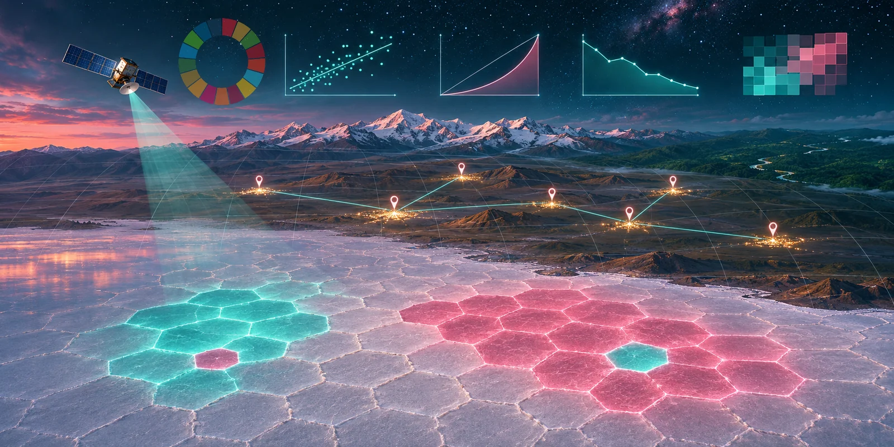

::: {.hero}
{fig-alt="The Andes and the Altiplano at night seen from orbit: city lights on the high plateau beside a lake and on the eastern lowlands, a satellite sensing them, a faint hexagon grid aggregating the lights into cells, the Sustainable Development Goals wheel, and a panel of charts (a scatter plot with a fitted line, a Lorenz curve and a trend)"}
:::

::: {.hero-lead}
**Find, load, map and analyse Bolivia's subnational development data, in Python.**
:::

```{=html}
<div class="hero-cta">
  <a class="g4-btn g4-btn--primary" href="get-started.html">Get started &rarr;</a>
  <a class="g4-btn g4-btn--colab" href="https://colab.research.google.com/github/quarcs-lab/geo4bolivia/blob/main/notebooks/get-started.ipynb" target="_blank" rel="noopener">▶ Open in Colab</a>
  <a class="g4-btn g4-btn--ghost" href="reference/index.html">Function reference</a>
  <a class="g4-btn g4-btn--ghost" href="https://quarcs-lab.github.io/gdo4bolivia/" target="_blank" rel="noopener">The observatory</a>
</div>
```

**geo4bolivia** is the Python package of the [GeoDevelopment Observatory of Bolivia](https://quarcs-lab.github.io/gdo4bolivia/). It gives you the observatory's data for 343 municipalities, 113 provinces and 9 departments, and the standard analyses of spatial data science, each in one call: maps, spatial dependence, convergence, transitions, inequality, regression and multiscale geographically weighted regression.

```python
!pip install -q geo4bolivia
import geo4bolivia as geo

geo.lisa("sdg", "index_sdg", year=2024)     # where are the clusters of sustainable development?
```

```{python}
#| echo: false
#| classes: g4-wide
import geo4bolivia as geo

geo.lisa("sdg", "index_sdg", year=2024)
```

## One package, three steps

::: {.grid}

::: {.g-col-12 .g-col-md-4 .g4-card}
### [Find and load](get-started.qmd)
A catalog you can search, documentation for every dataset, and panels with one row per unit and year, with names, boundaries and labels.

`datasets` · `search` · `info` · `load` · `describe` · `change` · `aggregate`
:::

::: {.g-col-12 .g-col-md-4 .g4-card}
### [Explore](explore.qmd)
A first look before any model: distributions, the highest and lowest units, correlations, trends, and maps in classes you can compare across years.

`distribution` · `extremes` · `correlation` · `scatter` · `trend` · `map`
:::

::: {.g-col-12 .g-col-md-4 .g4-card}
### [Analyze](analyze.qmd)
The fundamental analyses of regional data, with the boundaries and spatial weights found for you and a reading of every result in words.

`moran` · `lisa` · `beta_convergence` · `rank_mobility` · `inequality` · `spatial_model` · `mgwr`
:::

:::

## What you can do with it

| You want to know | Functions | Article |
| --- | --- | --- |
| What data are there, and what do they mean? | `datasets`, `search`, `info`, `dictionary`, `reference_years`, `cite` | [The data model](articles/data-model.qmd) |
| What does a variable look like? | `describe`, `distribution`, `extremes`, `correlation`, `scatter`, `trend` | [Exploring the data](articles/exploring.qmd) |
| Is it clustered in space, and where? | `map`, `weights`, `connectivity`, `moran`, `lisa` | [Maps and spatial dependence](articles/spatial-dependence.qmd) |
| Are the units that started lower catching up? | `beta_convergence`, `sigma_convergence`, `convergence_clubs` | [Convergence](articles/convergence.qmd) |
| Who moved up or down, and do neighbours matter? | `rank_mobility`, `lisa_transitions`, `transitions`, `spatial_transitions` | [Transitions and mobility](articles/transitions.qmd) |
| How unequal are the units, and between or within which groups? | `inequality`, `theil_decomposition` | [Regional inequality](articles/inequality.qmd) |
| What goes with what, once space is accounted for? | `regression`, `panel_model`, `spatial_diagnostics`, `spatial_model` | [Regression, panel and spatial models](articles/models.qmd) |
| Does an association change from place to place? | `mgwr` | [Spatial heterogeneity: MGWR](articles/heterogeneity.qmd) |
| How do I bring my own table or raster? | `link`, `check`, `zonal`, `aggregate`, `combine`, `overlay`, `save` | [Building your own indicators](articles/own-indicators.qmd) |

Every analysis function takes a dataset id or a table with a `geo_id` column, finds the boundaries, the spatial weights and the labels itself, and returns a **result object**: `.fig` (an interactive Plotly figure), `.df` (the table behind it), `.gt` (a formatted table where one helps), the numbers by name, and `.interpret()`, a reading in words that describes associations and never claims causes.

## Articles

::: {#articles}
:::

## The data

The package reads the observatory's published files from [quarcs-lab/gdo4bolivia](https://github.com/quarcs-lab/gdo4bolivia): nothing to download by hand, and a release tag (`ref="v0.7.0"`) freezes them for reproducible work.

| Dataset | What | Units and years |
| --- | --- | --- |
| `sdg`, `sdg01` to `sdg17` | [Atlas de los ODS en Bolivia 2026](https://atlasods.sdsnbolivia.org/) (Andersen & Argandoña, SDSN Bolivia): the Sustainable Development Index, 15 goal indices and 81 indicators | 343 municipalities, about 2012 and about 2024 |
| `pop` | Population (WorldPop) and population density | 333 municipalities, 2001 to 2020 |
| `ntl` | Night-time lights per capita (VIIRS) | 333 municipalities, 2012 to 2020 |
| `emb`, `embpw` | Satellite embeddings, 64 dimensions | 333 municipalities, 2017 |

The boundaries are SDSN Bolivia's municipal map of 2025, used with its permission. `geo.info(dataset)` gives each dataset's sources and licenses, and `geo.cite(dataset)` the citation and the credits they require.

## Sister packages

geo4bolivia covers the fundamentals. Two sister packages go further, and `geo.for_expdpy()` and `geo.for_geometrics()` hand any panel over to them:

- [**expdpy**](https://cmg777.github.io/expdpy/): panel exploration and econometrics (instrumental variables, event studies, correlated random effects).
- [**geometrics**](https://quarcs-lab.github.io/geometrics/): regional convergence and spatial econometrics with teaching sandboxes; geo4bolivia's analysis engine is ported from it.

## Cite

Mendez, C. (2026). *geo4bolivia: spatial data science for Bolivia's subnational development data* (version 0.7.0). <https://quarcs-lab.github.io/geo4bolivia/>

Please also cite the sources of the datasets you use: `print(geo.cite("sdg"))`.
